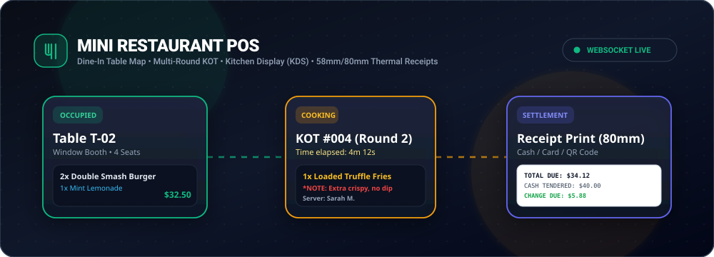

<p align="center">
  
</p>

<p align="center">
  <a href="https://fastapi.tiangolo.com/"></a>
  <a href="https://react.dev/"></a>
  <a href="https://vitejs.dev/"></a>
  <a href="https://tailwindcss.com/"></a>
  <a href="https://www.sqlite.org/"></a>
  
  
</p>

---

## 🍽️ Overview

**Mini Restaurant POS** is an ultra-fast, local-first Point of Sale system engineered specifically for mini restaurants, cafes, and bistros focusing on **Dine-In operations**, **multi-round Kitchen Order Tickets (KOT)**, **live Kitchen Display Systems (KDS)**, and **58mm / 80mm thermal receipt printing**.

Built on a zero-configuration SQLite architecture with full-duplex WebSockets, orders taken on waiter tablets or counter PCs sync across all screens in real time with zero external internet dependencies.

---

## ⚡ Animated System Architecture & Workflow

<p align="center">
  
</p>

```
  [Waitstaff Tablet / PC]  ──>  FastAPI WebSocket Hub  ──>  [Kitchen Display (KDS)]
           │                                                       │
     (Select Table)                                         (Audio Bell Rings)
     (Fire Round 1/2)                                       (Cooking ➔ Ready)
           │                                                       │
           └──────────────────> [Cashier Checkout] <───────────────┘
                                       │
                                (Settle Bill)
                                (Print 58/80mm Thermal Receipt)
                                (End-of-Day Z-Report)
```

---

## ✨ Core Features

| Feature | Description |
| :--- | :--- |
| **🪑 Floor & Table Map** | Visual grid of tables with live statuses (`AVAILABLE`, `OCCUPIED`, `BILLED`), guest capacities, active dining elapsed timer, and live bill total. |
| **🔄 Table Transfer** | 1-click migration of active dining guests from one table to another without interrupting open checks. |
| **🍔 Menu & Custom Notes** | Fast category tabs (Burgers, Pizza, Drinks, Appetizers), real-time search, and kitchen notes (e.g., *"extra spicy, no onions"*). |
| **🔥 Multi-Round KOTs** | Guests order appetizers first, mains later. Each round generates an incremental, numbered Kitchen Order Ticket (Round 1, Round 2...). |
| **🍳 Kitchen Display (KDS)** | Dedicated `/kitchen` screen for cooks with color-coded urgency badges, status controls (`Pending` ➔ `Cooking` ➔ `Ready`), and synthesizer chimes. |
| **🧾 58mm & 80mm Thermal Receipts** | Pixel-perfect monospace printing formatted for standard thermal receipt printers (auto-scaling to 58mm mobile or 80mm full rolls). |
| **💳 Multiple Payment Modes** | Supports **Cash** (with automated change calculation and quick cash bills), **Credit/Debit Card**, **Mobile Wallets (QR)**, or **Split**. |
| **📊 Daily Sales & Z-Report** | Real-time sales reconciliation, tax breakdown, average ticket size, top-selling items, and printable End-of-Day Z-Reports. |
| **⚙️ Admin & Catalog Manager** | Direct UI to add/edit menu items, toggle sold-out availability, add new tables/sections, and adjust tax/currency settings. |

---

## 🚀 Quick Start (Windows 1-Click)

The repository includes an automated launcher script for Windows:

```bash
# Simply double-click:
run.bat
```

This will automatically check your Python/Node environment, initialize and seed the SQLite database if it's your first run, and start both the backend and frontend servers!

---

## 🛠️ Manual Installation & Setup

### 1. Prerequisites
- **Python 3.10+**
- **Node.js 18+** & npm

### 2. Backend Setup (FastAPI + SQLite)
```bash
cd backend
python -m pip install -r requirements.txt
python seed.py               # Seeds sample tables, categories, and menu items
python -m uvicorn main:app --host 0.0.0.0 --port 8000 --reload
```
* Interactive Swagger API documentation will be available at: **`http://localhost:8000/docs`**

### 3. Frontend Setup (React 18 + Vite)
```bash
cd frontend
npm install
npm run dev -- --host
```
* POS Terminal & Floor View: **`http://localhost:5173`**
* Kitchen Display Screen (KDS): **`http://localhost:5173`** *(select Kitchen tab)*

---

## 🖨️ Thermal Receipt & KOT Printing

This application utilizes CSS `@media print` rules specifically calibrated for ESC/POS thermal printers:

- **80mm Rolls (`receipt-80mm`)**: Standard counter thermal receipt width (76mm printable area).
- **58mm Rolls (`receipt-58mm`)**: Compact handheld/mobile printer rolls (52mm printable area).
- Clean monospace text alignment with high contrast borders and zero paper feed clipping.
- Can be toggled inside **Settings ➔ Billing & Thermal Printer**.

---

## 📱 Local Network & Tablet Access

Because both the FastAPI backend and Vite frontend bind to `0.0.0.0`, any device on the same local Wi-Fi router (iPad, Android tablet, smartphone) can access the POS interface simply by visiting your host machine's local IP address:

```text
http://<YOUR-LOCAL-IP>:5173
```
*(e.g., `http://192.168.1.100:5173`)*

The frontend automatically detects `window.location.hostname` to route all REST API queries and WebSocket connections to the host counter machine on port `8000`.

---

## 📄 License
MIT License. Built for mini restaurants and bistros.
